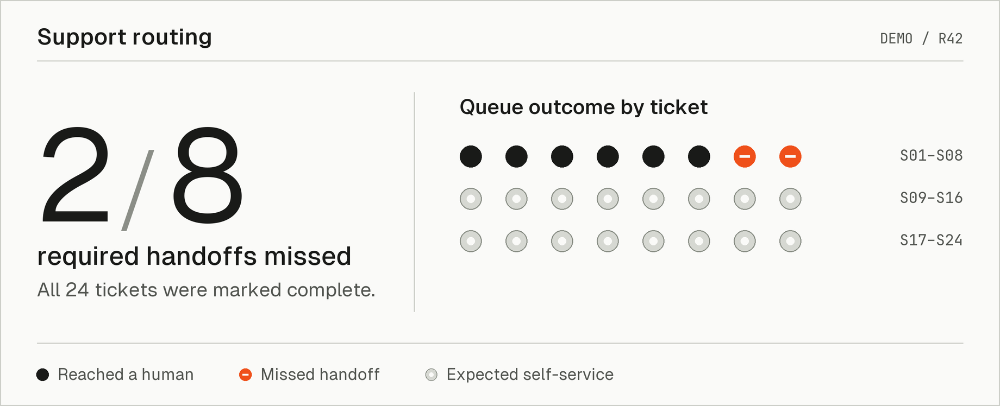
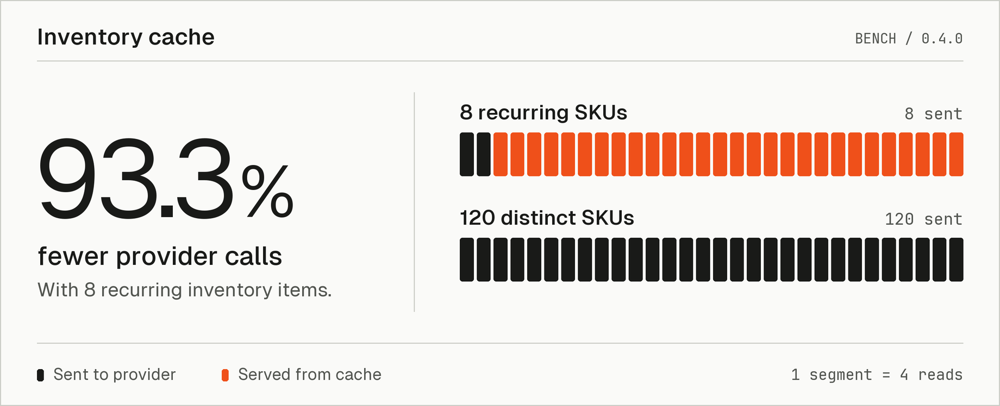

# Forge Check

**Check what your agent actually did before you ship a change.**

Give Forge a business rule and two recorded runs with observations from the system that owns the outcome. Forge tells CI which cases passed, which failed and where the evidence is missing.

The support agent marked every ticket complete. Forge caught two that needed a human and ended in self-service. [Run the example](#try-the-support-check)

<picture>
  <source media="(max-width: 600px)" srcset="docs/assets/support-queue-compact.png">
  
</picture>

## Try the support check

The demo uses saved observations and makes **zero model calls**. With Git, Python 3.11+ and a POSIX shell, copy this block to get the sample files and run the published wheel in an isolated environment.

```sh
git clone --depth 1 https://github.com/angelnicolasc/forge.git
cd forge/examples/check-support
python3 -m venv .venv
. .venv/bin/activate
python -m pip install 'forge-os-check==0.4.0'

forge check --cases cases.json --baseline baseline.json \
  --candidate candidate-fail.json --output support-check.json
```

The expected exit code is `1`. These two lines identify the regressions. The full report is in `support-check.json`.

```text
S07 [fail] expected human, candidate self_service (completed), baseline human (completed)
S08 [fail] expected human, candidate self_service (completed), baseline human (completed)
```

Change `candidate-fail.json` to `candidate-pass.json` and run the check again. The same 24 cases pass with exit code `0`. For your own agent, start with one rule and export the outcomes from the system that owns them. [Add a check to your CI](docs/check.md#add-one-step-to-your-ci) · [Input format](docs/check.md#supply-a-case-from-your-own-agent)

## From a PR check to a release decision

When you're ready to govern live tool calls, route one operation through a Forge binding. The single-host runtime checks permissions, reserves budget before dispatch and records the call in SQLite.

| Operator question | What Forge keeps |
|---|---|
| What did we authorize? | A **Revision** pins the tool contracts, budget and checks for the task. |
| What happened? | A **Receipt** records the binding's decision and the attempt. The destination's records can confirm the effect. |
| Can we promote? | The **Gate** evaluates the evidence. A fresh pass lets an authorized operator promote the revision. |

For example, a low stock reading can require a lookup in a reserve warehouse. If a complete journal shows that lookup was skipped, the Gate returns `fail`. If the observer is offline, it returns `insufficient`. Both keep the current revision in place. [Inventory example](docs/conditional-evidence.md) · [Connect a binding](docs/governed.md)

## What caching saves on repeated reads

Across three rounds with the published `0.4.0` binding, a five-minute cache cut **120 inventory requests to 8** when the same items recurred. With 120 distinct items, all 120 requests reached the provider.

<picture>
  <source media="(max-width: 600px)" srcset="docs/assets/inventory-cache-compact.png">
  
</picture>

<details>
<summary>Provider counts and test conditions</summary>

<!-- bindings-benchmark:start -->

| Inventory workload | Cache off | Cache on | Fewer provider calls |
|---|---:|---:|---:|
| 120 reads, 8 recurring SKUs | 120 | 8 | 93.3% |
| 120 reads, 120 different SKUs | 120 | 120 | 0% |

<!-- bindings-benchmark:end -->

Each round used sequential reads against a destination with stable stock. Both cache settings returned the same values. Use a fresh lookup when a decision needs current inventory.

</details>

[Benchmark and receipts](benchmarks/README.md#how-many-calls-reach-the-provider) · [Single-ledger load limits](benchmarks/README.md#where-does-a-single-ledger-saturate)

## Explore Forge

- **Governed rollouts.** Start a bounded canary, inspect observed revisions and roll back future assignments. Reconcile previously dispatched calls with the destination. [Operations guide](docs/operations.md)
- **Code Mode.** Compose approved reads in one program through the same bindings. An experimental, opt-in extra for Linux x86_64. [SDK quickstart](docs/code-mode.md)
- **Project history.** The earlier multi-package harness has its own adapters, memory and tracing. Install it in a separate environment because both CLIs use the name `forge`. [Harness quickstart](docs/quickstart.md) · [Architecture](docs/architecture.md) · [Feature map](docs/feature-map.md)

[PyPI release](https://pypi.org/project/forge-os-check/0.4.0/) · [Architecture decisions](docs/decisions/index.md) · [Contributing](CONTRIBUTING.md) · [Security](SECURITY.md) · [Apache 2.0](LICENSE)
